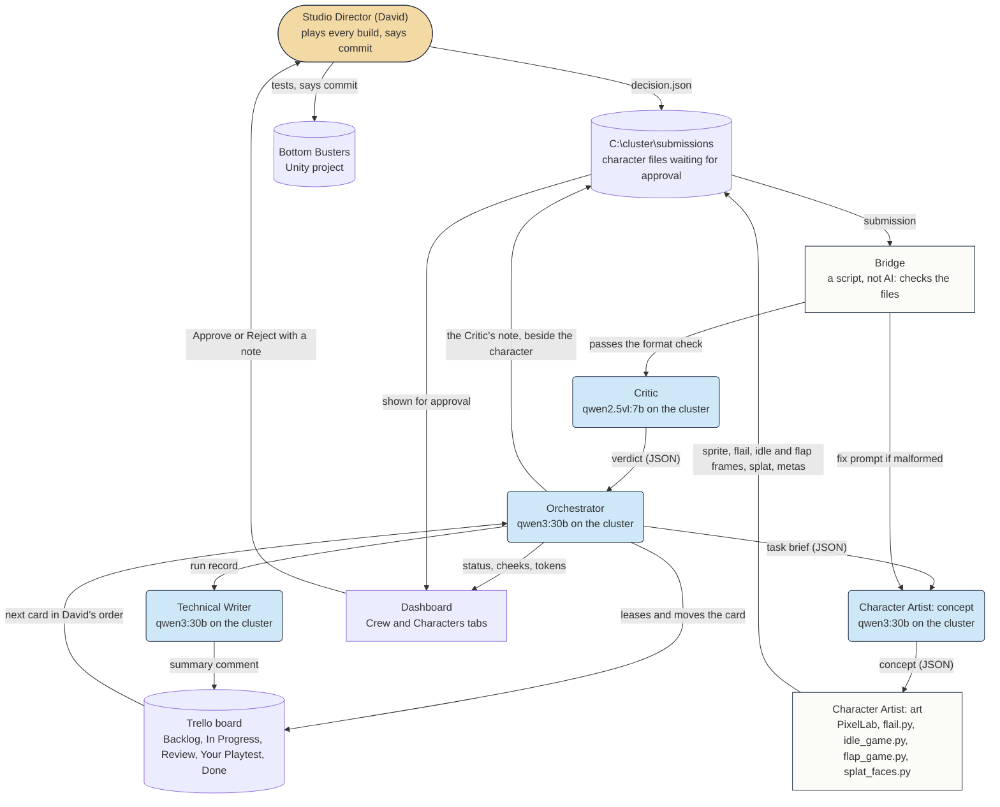

# Bottom Busters Agent Crew

Assignment #3, Multi-Agent AI for Game Development (ELVTR). David St. Onge, Tingle Games LLC.

## What this crew produces, and what game it's for

The game is **Bottom Busters**, a comedy arcade game for Steam and itch.io, built in Unity 6.3. Players are chubby men in white briefs who fly by farting and pop each other's cheeks.

This crew produces **new playable characters**, in sets of ten (`sets.json`). Each one keeps the same chubby body and white briefs and gets a new skin tone, face and hair, plus a first name. One character is 52 files in the formats the game already loads: a body sprite, 12 flailing-arms frames, 3 idle frames, 8 flying-arms frames, a splat pair, and the Unity import settings for each. The game shows no ethnicity information, just a list of characters with first names.

The crew works from my Trello board, top to bottom. The card order is my priority list. The Character Artist's card is the first one on the board with a maker, and more makers can plug into the same pipeline.

## The agents

| Agent | Kind | Job | Hands off |
|---|---|---|---|
| Orchestrator | Plain code, with qwen3:30b-instruct on the local cluster drafting the task list | Takes the next card, splits it into tasks, leases it to one maker, moves it across the board, runs the pipeline, and logs what PixelLab charged | Task briefs (JSON) |
| Character Artist | qwen3:30b-instruct for the concept and first name, PixelLab for the head, the game's own art tools for the animations | Designs a look and a name, has PixelLab paint the hair and face on the body's own pixel grid, and builds all the frames | A work folder and manifest |
| Bridge | A script, no AI | Checks the files before anything looks at them: frames, sizes, unique Unity ids, the body and briefs against the template, head skin against body skin, a first name, the game's slot limit, and hair, face and skin each measured against every character on the list | Pass, or a fix prompt back to the maker |
| Critic | qwen2.5vl:7b vision model on the local cluster | Looks at the line-up at game size and a close-up of the head, without seeing the concept, and says what's wrong | A verdict (JSON) |
| Technical Writer | qwen3:30b-instruct on the local cluster | Writes the run summary, keeps the crew's memory short, closes finished cards, keeps the diagram current | Summary, log, memory |

## How they work together

See `crew.mmd`. The same diagram:



- **Handoffs are files with a declared shape.** Agents never call each other. Every handoff is a JSON message in the run's `messages` folder, so any step can be read or re-run alone.
- **One writer for shared state.** Only the Orchestrator writes `run.json`, under a lock.
- **Malformed output is caught and fixed.** A model reply that isn't the JSON asked for gets one fix prompt. Files that fail the Bridge go back to the maker with instructions.
- **Plain code decides, and models draft.** The model drafts the task list, and code cuts it to the batch size. Rules on names and looks are checked in code.
- **Two cheeks per agent, like the characters in the game.** A send-back pops one, two pops stop the task and the run says why, and a finished job refills them. Each agent has a token cap per run and its own key, so its usage is counted separately.
- **Failed work stays out of sight.** A character is built in a work folder and reaches the approval screen only after the Bridge passes it. If the run stops, the last attempt stays in the run's folder and the card goes back to the Backlog.
- **The Critic gives a note, and it can't send work back.** Its verdict goes beside the character on my approval screen. On the first character it said the hair was detached from the head. That was wrong as far as I can see in the picture, and it would have stopped the run. It won't get the power to send work back until it has been tested on art with known answers.
- **Memory stays short.** The Technical Writer keeps one line per run and folds old lines together, so a run starts from a short summary instead of everything that came before.
- **A person is the last gate.** The crew stops at Your Playtest. I approve or reject each character on my dashboard, and nothing is committed without my say-so. The shipped game contains no AI from this crew, only the files it made.

## What keeps the art consistent

PixelLab paints only the masked hair, face and beard areas, on the sprite's own 88 by 88 grid, and keeps every other pixel. The Bridge checks that the briefs still match the template pixel for pixel. Plain code converts the skin it paints to the template's skin and moves the head to the character's tone the same way as the body, so they match.

The animations aren't drawn per character. The flailing arms are the template's own frames wearing the new head, the idle comes from `idle_game.py`, the flying arms come from `flap_game.py` using a flap made once with PixelLab, and the splat comes from `splat_faces.py`. Those are the tools that made the original ten.

## The official run

Made by the crew on 2026-11-01, with the record in `official_run`: the handoff messages and summary of each run, and previews of each character.

| Character | Look | Bridge | Critic | PixelLab |
|---|---|---|---|---|
| Darnell (`player11`) | Round black afro, narrow eyes, thin brows, chestnut skin | Passed | Failed it: "afro hair is detached from the head" | 1 call, 5 generations |
| Marvin (`player12`) | Black cornrows forming a crown, narrow brows, squinting eyes, chestnut skin | Passed | Passed | 1 call, 5 generations |

Darnell's run also spent one more call on an attempt the Critic turned down, and the Critic's second "fail" stopped that run. After that I changed the Critic's fail to a note, as described above, and Darnell went on to the approval screen from that run. Marvin came from the next run.

The crew also gave the original ten first names, which I approved: Larry, Doug, Norm, Greg, Carl, Steve, Barry, Terry, Kevin and Phil.

**Status: I approved both characters on the dashboard, with one note on Marvin: "death splat needs to be frowning instead otherwise everything is good". That's the next fix. Neither character has been installed or tested in the game yet.** `install_character.py` puts an approved character into the project, and it has only been run against a temporary copy.

## Running it

```
python orchestrator.py          one run; skipped if the game is running
python orchestrator.py --now    one run even if the game is running
python test_pixellab.py         the PixelLab calls, with the web stubbed out
python test_bridge.py           the Bridge on the original ten and on copies broken on purpose
python test_character_artist.py the Character Artist, with stand-ins for PixelLab and the cluster
python test_install.py          the install tool, on a temporary copy of the project's files
python test_sendback.py         the send-back and stop paths, using no model time
```

The tests use stand-ins, so they show the code does what it was written to do. They don't show the art is good. Only a real run and my own eyes can do that.

It needs my local setup, so it won't run elsewhere as is: the model cluster behind MindRouter, a PixelLab account, the Bottom Busters project, a Trello key, and `common.py`, which isn't in this repository (see `common_README.md`). API keys aren't in this repository either.

A Windows scheduled task, `BBUST Crew`, can run it every 30 minutes. It's registered and turned off.

## Files

| File | What it is |
|---|---|
| `orchestrator.py` | The Orchestrator, and the file you run |
| `character_artist.py` | The Character Artist |
| `parts.py` | Separates a sprite into skin, hair and face, and finds the eyes and mouth |
| `bridge.py` | The Bridge |
| `critic.py` | The Critic |
| `technical_writer.py` | The Technical Writer |
| `pixellab.py` | The PixelLab calls, and what each one cost |
| `board.py` | The Trello board |
| `common_README.md` | Stands in for `common.py`, the shared code for the cluster call, cheeks, run state and handoff messages. It's left out because it holds details of my private network |
| `install_character.py` | Puts an approved character into the Unity project |
| `test_*.py` | The tests |
| `sets.json` | The eight sets of ten, with their skin tones and hair notes |
| `roster.json` | The ten current looks, for the concept step |
| `limits.json` | How far a new character has to measure from every other one |
| `crew.mmd` | The Mermaid diagram |
| `official_run` | The record of the official run |
