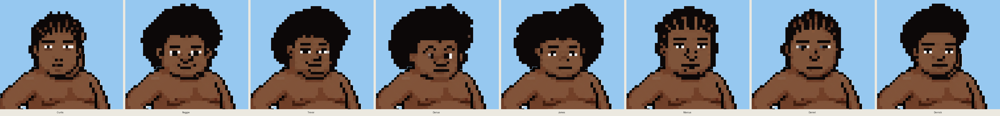
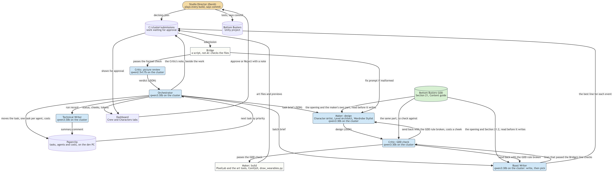

# Bottom Busters content pipeline, driven by the GDD

Assignment #4, Multi-Agent AI for Game Development (ELVTR). David St. Onge, Tingle Games LLC.

The Studio Director, here and in the GDD, is David St. Onge, who approves or rejects everything the crew makes.

The Assignment #3 crew made characters without reading the design document. For this assignment every maker reads the game's GDD before it writes anything, and a Critic checks each piece of work against the same part of the GDD before any art is made. Work that breaks a GDD rule goes back to its maker with the rule quoted, and costs it a cheek. Two lost cheeks stop the task.

The GDD is `BOTTOM_BUSTERS_GDD.md` in the folder above this one. Section 21, the **Content guide**, was written for this assignment: an opening every agent reads, then one part per maker (21.1 Characters, 21.2 Roast lines, 21.3 Hats and shades, 21.4 Backgrounds).

## What it generated

All of it was made on 2026-11-07 by the crew on the local cluster (qwen3:30b-instruct and qwen2.5vl:7b through MindRouter), PixelLab for the character heads, ComfyUI for the background objects, and the game's own drawing code for the hats. Nothing was drawn or written by hand.

| Content | Maker | Made | Where |
|---|---|---|---|
| Playable characters | Character Artist | 8: Curtis, Reggie, Trevor, Darius, James, Marcus, Daniel, Derrick. They fill the first set (African American) to its 10, with Darnell and Marvin from Assignment #3 | `official_run/characters/`, `official_run/the_8_new_characters.png` |
| Roast lines | Roast Writer | 22, across 7 of the game's 11 roast events | `official_run/roast_lines.md` |
| Hats | Wardrobe Stylist | A Top Hat, rejected by the Studio Director ("its upside down"), then redrawn from that note | `official_run/hats/` |
| Backgrounds | Level Architect | 1 parallax backdrop, "haunted mansion on a crooked hill", 5 layers | `official_run/background/` |

Every item waits for the Studio Director's Approve or Reject in Paperclip before it can go into the game.

**Did it run?** Yes. Every output here came from the crew's runs on 2026-11-07, which are in `official_run/runs`. Five of those nine runs finished with their work up for approval. Four stopped: the first three, when the Critic was too strict (see What the Critic caught), and one character run, which twice picked a name that was already taken on its fourth character, after it had made Curtis, Reggie and Trevor. The next run made the other five. All 17 crew tests pass (`evidence/tests.txt`).



## How the GDD drives it

`code/gdd.py` reads the GDD file on every run (never a copy) and hands each maker the opening of Section 21 plus its own part, and nothing else. Every prompt a maker writes content from starts with that block. This is the start of a real Character Artist prompt, from `official_run/runs/20261107-171522-character-artist/prompts.jsonl`:

```
From the Bottom Busters game design document (GDD), Section 21, the Content guide: its opening and Section 21.1.
Read it before you write anything. Everything you make follows it.

## 21. Content guide
...
End of the GDD extract.
```

`code/test_gdd.py` checks that every generating prompt of all four makers opens this way, that each maker gets only its own part, and that a missing GDD, Section 21 or part stops the run instead of letting a maker write without it.

## The consistency check loop



The Assignment #3 crew, for comparison: `diagrams/crew_before.png`. Both diagrams are also Mermaid source (`crew_before.mmd`, `crew_after.mmd`).

1. **Design.** The maker writes a design from the GDD: a character concept, a background recipe or a hat recipe. The Roast Writer writes lines.
2. **GDD check.** The Critic (qwen3:30b-instruct) reads the same GDD part and the design. Each problem it raises has to quote the GDD rule and the exact words in the work that break it. Plain code throws out a problem whose rule isn't in the GDD, that hedges ("may", "in spirit"), that blames words the work doesn't contain, that quotes a sentence describing the game rather than a rule, or that judges a text design on how the finished picture will look. What's left goes to two separate second looks that see only the rule and the blamed words, never the Critic's argument, and both must agree it's a break.
3. **Send back or build.** A fail goes back to the maker with the GDD rule, and costs a cheek. A pass is built: PixelLab paints the head, ComfyUI paints background objects, the game's code draws the hat.
4. **Bridge.** Plain code measures the files: a new face against every face on the roster, holes inside background objects, a hat that would float above the head. A fail goes back to the maker with the measurement.
5. **Picture review.** The Critic's vision model looks at the finished art. Its verdict is a note beside the work for the Studio Director, not a gate, because it hasn't been tested on art with known answers.
6. **Approval.** The work goes up on an approval card in Paperclip. A reject's note becomes a redo card, as the Top Hat's did.

Every handoff is a JSON file in the run's `messages` folder, and every model prompt and reply is in its `prompts.jsonl`. Curtis is one full loop in `official_run/runs/20261107-170123-character-artist`: design, GDD check passed, built, sent back by the Bridge (face too close to Darnell, 29.6 against the 29.7 needed), redesigned, GDD check passed again, built, passed the Bridge, picture review, approval card.

## Does it sound like the game?

**Roast lines, mostly yes.** The GDD voice is a flat verdict and then a turn, deadpan and formal, with the gross thing never named. Lines like these fit it:

- "That was not a strategy. That was a statement." (Longest Streak Of Poo, win)
- "Efficient. Unpleasantly thorough. Well done." (Received, win)
- "The lifeguard is off duty. A permanent one." (Lifeguard Off Duty)
- "On target. The structural integrity is not." (Direct Deposit, win)

Where it falls short: 6 of the 22 use the same shape. Four are "That was not X. That was Y." and two say it in other words ("It’s not a streak. It’s a warning."). The GDD lists that as a failure ("The same shape over and over"). The Critic checks each line on its own, so it doesn't see repetition across a batch. "Efficient. Unpleasantly thorough. Well done." also leans on the kept line "Efficient. Brutal. Faintly upsetting." The Studio Director's approvals are the final word on what's funny.

**Characters, partly.** All 8 keep the same chubby body, the same cartoon face with two eyes, brows, a nose and a mouth, and no hats, glasses or masks, as Section 21.1 asks. The names are classic real first names, with no jokes or nicknames. Every face passed the Bridge's measured difference from every character made before it. Looking at them side by side, the set is short on variety: all 8 have black hair, five have rounded afros (Reggie, Trevor, Darius, James, Derrick), and two have cornrows (Marcus, Daniel). The face check compares each new character with the roster, not with the others made in the same batch.

**Background, yes.** The haunted mansion keeps the GDD's layer system (a code-made sky, a haze band, one kind of object per layer) in violets, the palette the Studio Director liked in the first test.

**Hat, not yet.** The Studio Director rejected the first Top Hat as upside down. The redo is drawn from that note, but it still looks much like the first one. It's waiting on his call.

## What the Critic caught

The full record is `evidence/critic_log.md`, compiled from every run's `run.json`. Across the day's runs it checked 32 designs and 140 roast lines.

**Real catches, against the GDD's own words.**

- Five Direct Deposit lines that lean on a pun ("a memorial", "a monument", "a historical event", "in the timeline", "the air is still recovering"). GDD 21.2: "A line that explains the joke or leans on a pun alone."
- "No margin. No mercy. No explanation." has no turn after the verdict. GDD 21.2: "A flat verdict, then a turn."
- In the known-answer test (`evidence/critic_known_answers.txt`), it failed every piece of bad work: a feather headdress ("no feathers, headdresses or face paint"), a Nike swoosh cap ("Real logos, brands or team names"), a Bowser's castle background ("Nothing is copied from ... characters from other games or shows"), "You pooped all over them" (the gross thing named), "Nice belly" (a character's body), and a Mario reference ("No pop culture").

**What the Critic got wrong, and what changed.** The first run (`official_run/runs/20261107-155047-*`) shows the loop working, and the Critic too strict to be useful. It stopped three of the four makers with nothing made, on findings like these:

- "Just the smell" failed for naming the gross thing, when the rule it quoted allows "a smell".
- "No survivors. No witnesses. No dignity." failed as pop culture.
- A character failed because his beard "may create a caricature ... in spirit, though not in letter", quoting the no-hats rule.
- A top hat failed twice on guesses about how it "may not" look.

The plain-code filters and the two blind second looks described above came from that run. In the runs after it, they threw out 114 findings:

| Why a finding was dropped | Findings |
|---|---|
| A maybe, not a break | 82 |
| It blames words the never-named rule allows | 16 |
| The second look found no break | 9 |
| It judges how the finished art will look from text | 4 |
| It quotes a sentence describing the game, not a rule | 3 |

One questionable fail still got through: a character with "thick brows, small eyes" was sent back as exaggerated (`evidence/screenshots/paperclip_gdd_check_sendback_BOT-124.jpg`). The same check, rerun after these fixes, got all 16 cases with a known answer right.

**What plain code caught after the GDD check.** The Bridge sent back 15 pieces of art, most of them new faces too close to Darnell's or Marvin's, who share the set's skin tones. It also caught holes inside the background objects and a hat floating above the head. Those two led to plain-code fixes in the makers: small gaps inside objects are now filled, and a hat is moved down until it sits on the head. Two of the 15 were a Bridge bug, since fixed: it blocked the Top Hat's redo because the rejected Top Hat already had the name.

## Running it

The crew runs on the dev PC against the local cluster, with PixelLab, ComfyUI and Paperclip set up there:

```
python orchestrator.py                          # every maker with a card on the board
python orchestrator.py --maker character-artist # one maker
```

The tests use stand-ins for the models, so they need none of those services. All 17 pass (`evidence/tests.txt`):

```
python test_gdd.py
python test_sendback.py
```

## Files

| Path | What it is |
|---|---|
| `code/` | The crew's code for this assignment: `gdd.py` (the GDD reader), `critic.py` (the GDD check), `orchestrator.py`, the four makers, the Bridge, and their tests |
| `crew_before.mmd`, `crew_after.mmd`, `diagrams/` | The crew diagram before (Assignment #3) and after, as Mermaid source, SVG and PNG |
| `official_run/` | What was made, and the runs that made it: `run.json`, the handoff files in `messages/`, and every prompt and reply in `prompts.jsonl` |
| `evidence/critic_log.md` | Every GDD check, send-back, dropped finding and Bridge catch, run by run |
| `evidence/critic_known_answers.txt` | The Critic's GDD check on work with known answers, real model, and the script that ran it |
| `evidence/tests.txt` | The output of all 17 crew tests |
| `evidence/screenshots/` | Paperclip: a GDD check that passed, one that sent work back, and an approval card |
