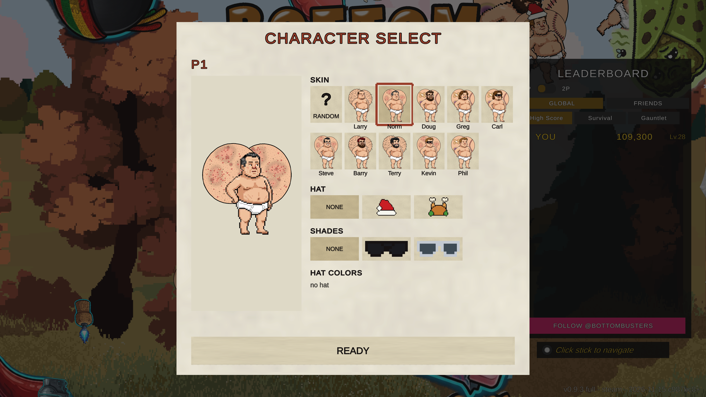

# Bottom Busters Builder: a goal-oriented coding agent

Assignment #5, Multi-Agent AI for Game Development (ELVTR). David St. Onge, Tingle Games LLC.

The Studio Director, here and in the GDD, is David St. Onge, who approves or rejects everything the agent makes.

The game is **Bottom Busters**, a comedy arcade game in Unity 6.3: chubby men in white briefs fly by farting and pop each other's cheeks. Its GDD already described this agent before it existed. Section 16, the Builder: "Reads this GDD and the project's coding rules and implements one approved feature at a time in C#, then runs the existing build-and-verify loop." This assignment builds it.

## In short

- **What the agent built:** first names under every character tile on Character Select (GDD Section 21.1), in the real game. The screenshot below is from the full Steam build.
- **Why that feature:** the agent ranked the 17 gaps it found with `priority_score()` and stopped for approval. Its top pick was "More playable characters." At that stop, the Studio Director approved first names instead, a requirement the agent had listed as unconfirmed: small, visible to players, and clear of files another session was editing. Scored the same way, it rates 5 against the pick's 4.
- **What I changed by hand:** four things. Larry had no name (one line). The agent's "unverified" note became a checked one. The agent's label didn't show on screen, so it now uses the setup of the RANDOM tile's word. And the names moved under the tiles, at the Studio Director's request.



## What the agent built

**First names on Character Select.** Every character tile now shows the character's first name under it: Larry, Norm, Doug, Greg, Carl, Steve, Barry, Terry, Kevin and Phil, in the order the tiles appear. GDD Section 21.1: "The game shows no ethnicity information, just a list of characters with first names." The names are the Studio Director's ruling of 2026-11-01. Before this run, the names were nowhere in the game's code.

- `Assets/Scripts/Characters/CharacterNames.cs`, a new file: the names, which name goes with which character, and the label on the tile.
- `Assets/Scripts/UI/CharacterSelect.cs`, a 3-line hookup where each skin tile is built.

It's in the real game, the one codebase every version builds from: the Steam demo and full copy, the itch demo and full copy, and the browser build. With the agent's change and the hand changes below, all four Windows versions built with 0 errors (`HeadlessBuild: Succeeded`, `evidence/final_builds.txt`), and the Studio Director played the full Steam copy and saw every name under its tile (`evidence/character_select_names.png`). The code the agent wrote is `official_run/20261115-161537/change_1/change.diff`; the code that went into the game is `official_run/CharacterNames_accepted.cs` and `official_run/CharacterSelect_accepted.diff`.

The agent's own code check found it built afterwards. On its rescan (pass 6), the requirement moved from not found to confirmed in the code: 61 requirements confirmed instead of 60, and 16 gaps instead of 17.

Claude Code wrote the accepted code. The local cluster model (qwen3:30b-instruct) went first and failed twice: its new file began with stray markup the compiler rejected (`error CS1525: Invalid expression term '<'`). Then its two cheeks were gone, and Claude Code took over, as designed.

## Why that feature

The agent reads the whole GDD, one section at a time, and turns it into requirements: 346 in this run, each with a quote that plain code checked word for word in the GDD (51 claims were dropped for failing that check). It scans all 171 of the game's C# files and sorts every requirement into three groups:

- **Confirmed in the code** (60): the GDD calls it built, and specific names it expects (a method, a field, an exact string) were found.
- **The GDD calls it built, but the search couldn't confirm it** (263): listed for a person to check, never built automatically. Writing a second copy of a working feature is the worst thing this agent could do to the game, and a search over 56,000 lines misses a lot.
- **Gaps** (17): what the GDD's own words call planned, a teaser, for the full game or planned later, and that a second look at the code didn't find.

Then `priority_score()` ranks the gaps:

```
score = 3 x unblocks   finished crew work of this kind is waiting outside the game, and the GDD paragraph names it
      + 2 x ruling     the GDD paragraph carries a dated Studio Director ruling
      + 2 x visible    a player sees it
      + size           1 file and about 120 lines or fewer: 2; up to 3 files and 300 lines: 1; bigger or unknown: 0
skipped: a file it would change has someone else's uncommitted work, or it stopped twice on it before
```

The weights put unblocking first because the crew's work is piling up: 31 new characters, 13 backgrounds, 22 roast lines and 2 wardrobe items wait in `C:\cluster\submissions` for the game to take them.

**The agent's own pick was "More playable characters"** (GDD Section 7, planned), scored 3 x 1 + 0 + 0 + 1 = 4: 31 characters waiting, one small change. Six gaps were skipped, among them the full game's 200-level cap and Steam Cloud sync, because they run through files another Claude session had changed and not committed while making the browser version (`GameManager.cs`, `ItchOnline.cs`, `MainMenuController.cs`).

**The Studio Director approved first names instead, at the agent's approval stop.** The agent never writes before he approves its pick. First names was on the agent's "the GDD calls it built, but the search couldn't confirm it" list. He checked it, it wasn't built, and his approval made it a gap. Scored the same way, it comes to 5: 3 x 1 (the 31 waiting characters are what the names list is for) + 0 (the "Sets." paragraph has no dated ruling of its own) + 2 x 1 (visible) + 0 (size unknown). It was recommended to him as small, visible today with the original ten characters, and clear of every file the browser session had open. The agent's own pick planned changes to `CharacterBase.cs` and `CharacterIdle.cs` (`ranking_pass1.json`), while the game loads its character slots in `GameManager.cs`.

## What I changed by hand before accepting it

1. **Larry had no name.** The agent's code finds a character's name from the number in its art file (`player2` is the second name, and so on), which also handles the swapped prefabs correctly: `player2Prefab` wears `player3`'s art. But the first character's art is `player`, with no number, so Larry's tile would have shown no name (found reading the code, before the build). Fixed with one line: art named `player` counts as number 1.
2. **Its "UNVERIFIED" note became a checked one.** The agent marked its own name order as unverified. I checked it against the art and the GDD's roster table (`evidence/character_select_tiles.png`): the order is right, and the note now says so.

3. **The names didn't show.** The game ran the agent's code: the menu log listed all ten names, matched to the right art, with no errors. But no name appeared on screen. The agent's label had its own setup, with a paper-colored outline and auto-sizing; the RANDOM tile's word, which does show, has neither. I replaced the agent's label with the same helper the RANDOM word uses, and the names appeared. Which of those two settings hid them wasn't tested separately. The agent's label code came out of `CharacterNames.cs`; its name matching stayed.
4. **Names under the tiles, the Studio Director's call.** After fix 3, each name sat inside the bottom of its tile, where RANDOM shows its word. He wanted each name under its tile. Each row of character tiles got a 20-pixel strip for its names, and everything below them (hats, shades, colors and READY) moved down 40 pixels, with the panel 40 pixels taller. This is a design change, not a bug in the agent's code.

All four are in `official_run/hand_changes.diff`: the agent's version against the one that went into the game. What's still the agent's work: the list of names, matching each name to its character's art, and the hookup where each tile is built.

The lesson for the agent: its build step proves the code compiles, not that a player can see the feature. Fix 3 was found only by playing the game.

## How it works

`code/builder.py` is the agent; `code/codebase.py` is the code scan; `code/gdd.py` and `code/common.py` are the crew's shared pieces from Assignments #3 and #4, with `gdd.sections()` added.

1. **Read the GDD.** One model call per section (sections 0, the change list, and 20, the risks, are skipped). Plain code checks each quote word for word, and the GDD's own words decide the status, not the model.
2. **Scan the code.** Every `.cs` file under `Assets/Scripts`, and `git status` for files another session is working on.
3. **Gap pass.** Planned requirements get a second look: the model sees the code search found and must quote a line that proves the feature is built. Plain code checks the quote is really in the code, and a class declaration doesn't count as proof.
4. **priority_score()** ranks the gaps, as above. The run stops and waits for the Studio Director's yes.
5. **Write.** The writer sees the feature, the GDD's whole section, the file that holds the feature's own class in full, and the game's coding rules. It answers in NEW FILE and EDIT blocks. Plain code refuses any edit that isn't found exactly once, any path outside `Assets/Scripts`, and any file someone else has changed. Nothing is written unless every part passes.
6. **Build.** The game's own headless build. If it fails, the compiler errors go back to the writer. Two failures cost the writer both cheeks (like the characters in the game), and the next writer takes over: the cluster model first, then Claude Code. When every writer is out, everything is put back exactly as it was.
7. **Rescan.** After each write it scans again, to confirm the gap closed. It stops when every requirement it can build is met, when it reaches its limit (one feature per run on the real game, as the GDD says), or when something stops it.

## What went wrong in the official run, and what changed

The run is one folder, `official_run/20261115-161537`, with six passes, and every pass's ranking is in `ranking_pass1.json` to `ranking_pass6.json`. The run made 64 cluster calls and 3 to Claude Code. Its prompt log, `prompts.jsonl`, isn't published here: the prompts carry whole source files from the game (all of `CharacterSelect.cs`, for one), and this repo is public while the game's code is not. The log is kept with the agent on the dev PC. The first three tries at the approved feature stopped with nothing written to the game:

| Pass | What happened | What changed |
|---|---|---|
| 1 | Ranked the gaps and stopped for approval | - |
| 2, 3 | The second look planned the names change through `GameManager.cs`. The guard refused, because another session had it open. Search had never shown the second look `CharacterSelect.cs`: three other files matched more search words, and it sees only three. | A file that declares a class the feature names is shown first. For an approved feature, it's also told which files are off limits. |
| 4 | The second look claimed names were already built, quoting `public string name;` from `Wearables.cs`, which holds hat names. The cluster model then edited files that don't exist. Claude Code refused to write: "I wasn't shown the Character Select screen." | For an approved feature, the file of its own class goes to the writer first and whole, the GDD's whole section goes with it, and his approval overrides the "stopped twice" mark. |
| 5 | The cluster model's code didn't compile, twice. Claude Code's did. The game built. | - |
| 6 | Rescan: the gap is closed. Stopped at its limit of one feature. | - |

Each fix has a test, and the tests name the run.

## Tested before the run

- **52 tests** with a stand-in model, a small fake game in a temp git repo and a fake build, so no cluster time and nothing near the real game (`evidence/tests.txt`).
- **A practice loop with the real models** on a scratch Unity project, with real compiles (`evidence/practice/loop_on_practice_game`). It built three features one after another, confirmed each closed on the rescan, and when a fourth wouldn't compile it put everything back and stopped. That run found the cluster model copying line numbers into its edits, which is now handled.
- **Three read-only rankings on the real game** (`evidence/practice/ranking_on_real_game`). The first found 68 gaps, most of them features already in the game, and its top pick was one of those. That's why the GDD's words now decide status and built features are never rebuilt.

## Tokens

The run used 253,458 tokens on the local cluster (counted on the Builder's own MindRouter key) and 19,499 on Claude Code. The GDD gives the Builder 3 million for the semester.

## Running it

It runs on the dev PC against the local cluster and the game's repo:

```
python builder.py --dry                         rank the gaps, name the pick, write nothing
python builder.py --resume <run> --only <id>    build the requirement the Studio Director approved
python builder.py --max N                       up to N features, rescanning after each
python -m pytest test_builder.py test_codebase.py -q
```

The plan it was built from is `BUILDER_PLAN.md`.
